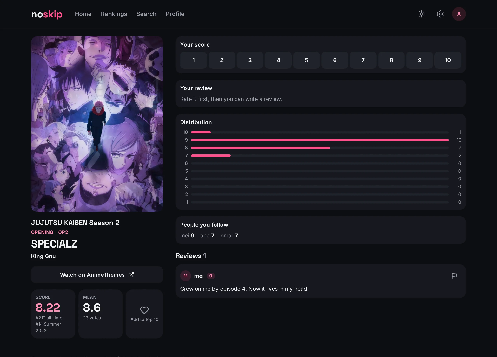
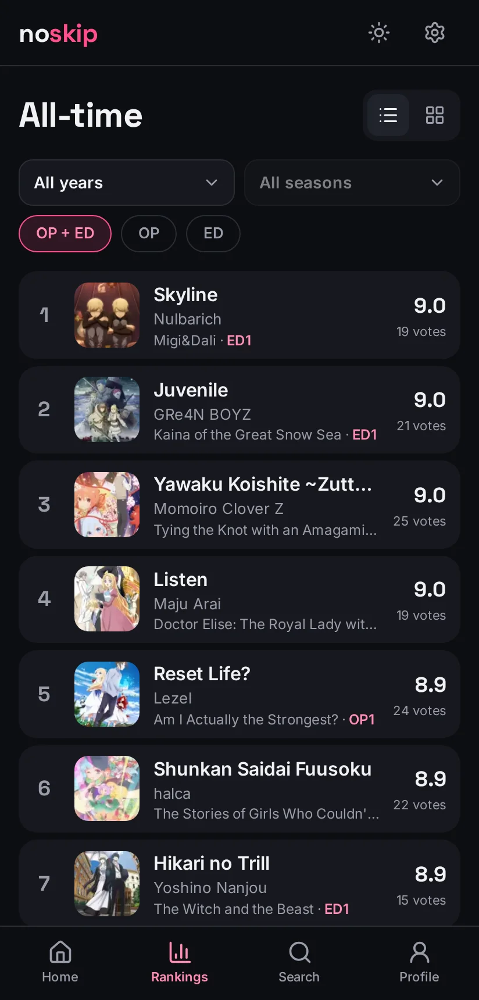
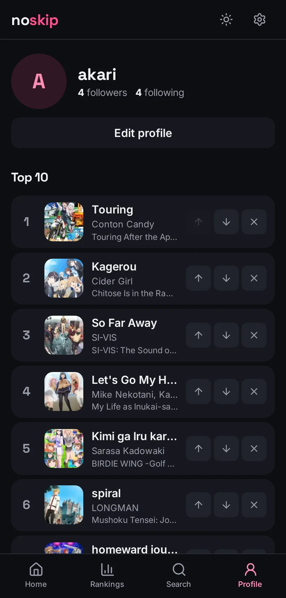
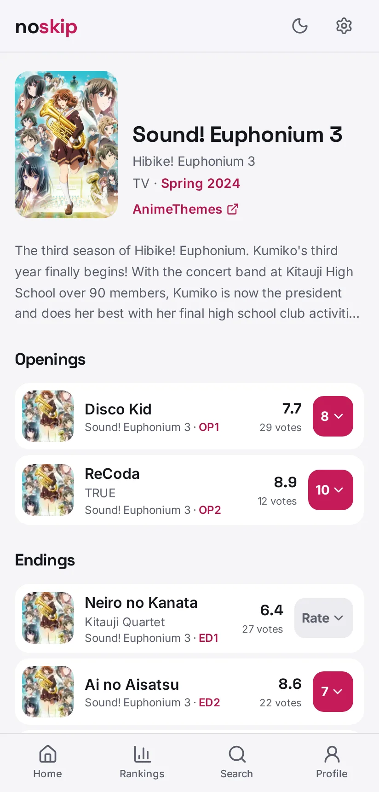

# NoSkip

[](https://github.com/icarosuper/noskip/actions/workflows/ci.yml)

**Rate anime openings and endings 1–10, and see which ones fans rank best: all-time, by year and by
season.** Think AniList, but only for OP/ED: scores, reviews, a personal top 10, and following other
people to see their scores.

> **Status: work in progress, not deployed yet.** The core loop works end to end (sign in → rate →
> review → rankings), and the production basics are in: CI, logs, rate limiting, health check. The
> open items are in [docs/TODO.md](docs/TODO.md). The screenshots below show the real AnimeThemes
> catalog; the users, scores and reviews are generated demo data (`bun run db:seed-demo`).

<p align="center">
  
</p>
<p align="center">
  
  
  
</p>

## Engineering highlights

Each choice that looks unusual has a numbered entry in
[docs/agents/decisions.md](docs/agents/decisions.md) saying why it was made and what not to "fix".

- **The catalog is a local copy, never queried live.** An importer pages through the
  [AnimeThemes](https://animethemes.moe) GraphQL API under its rate limit and upserts by upstream
  id. It **never deletes**, because ratings point at themes and must survive upstream churn
  ([#1](docs/agents/decisions.md#1-the-catalog-is-a-local-copy-of-animethemes-upserted-never-deleted)).
  Every page is validated with zod before anything is written, and a contract test checks a
  recorded real response, so an API change fails a test instead of corrupting data.
- **Bayesian rankings.** A theme with two 10s doesn't beat one with two hundred 9s: each score is
  pulled toward the mean of its ranking (all-time or season) until the theme has enough votes
  ([#4](docs/agents/decisions.md#4-rankings-use-a-bayesian-average-computed-per-request)).
- **Runs on any Node host.** The only host-specific line is the build preset. Logs are JSON on
  stdout, and jobs like the catalog sync are CLIs run by an outside scheduler (a GitHub Actions
  workflow here), never by the app
  ([#13](docs/agents/decisions.md#13-the-app-runs-on-any-node-host-jobs-run-outside-it)).
- **Abuse limits that hold on serverless.** Write limits are counted in Postgres with one atomic
  upsert, not in memory, so every instance shares the same count. Every write starts with
  `authorizeWrite()`, and a test fails any write server function that skips it or accepts a user
  id from the client
  ([#14](docs/agents/decisions.md#14-write-rate-limits-are-counted-in-postgres-one-budget-per-user)).
- **SSR without flashes.** The theme (light/dark) and the list/grid choice are applied by an inline
  script before first paint, so server and client render the same markup with no hydration
  mismatch ([#10](docs/agents/decisions.md#10-theme-stage-tokens-per-theme-choice-saved-in-the-browser),
  [#12](docs/agents/decisions.md#12-listgrid-is-saved-per-screen-and-applied-by-css)).
- **The database enforces the rules.** Score range, the top-10 limit and "no review without a
  rating" are `CHECK`s and composite foreign keys, not just form validation. Deleting an account
  cascades to everything the user created.

## Testing

| Suite | What it covers |
|---|---|
| Unit (Vitest) | ranking math, importer parsing and retries, the write-ownership guard |
| Integration (Vitest) | the queries and the importer against a **real Postgres**, reset before each test, including "another user's write never touches my rows" checks |
| E2E (Playwright) | real user flows on desktop **and** mobile, signed in without OAuth; any console error fails the test |
| Guards on every page | axe-core accessibility scan, horizontal-overflow check on each viewport |

[CI](.github/workflows/ci.yml) runs all of it on every push, plus a check that the schema and its
migrations agree. How the suites are organized: [docs/agents/testing.md](docs/agents/testing.md).

## Built with an AI pair, on purpose

The repo is set up so a coding agent (Claude Code) can work in it safely and leave it better
documented than it found it:

- [CLAUDE.md](CLAUDE.md) holds the always-on rules; `docs/agents/` holds architecture, conventions,
  a features index and the decisions log, each saying when to read it.
- Project skills in [.claude/skills](.claude/skills): `review-ui` runs the real app on a seeded
  fixture database and drives a headless browser to review screens, `schema-change` walks a
  migration end to end, `record-decision` adds entries to the decisions log.
- A hook formats every file the agent edits, and the agent never commits without approval.

## Stack

TanStack Start (React 19, SSR, file-based routing) · PostgreSQL + Drizzle ORM · Better Auth
(Discord, Google) · Tailwind CSS v4 · zod · pino · Vitest · Playwright · Biome · bun

## Running locally

```bash
bun install
cp .env.example .env.local        # then fill it in
bun run db:up && bun run db:migrate
bun run import:animethemes --current-season
bun run dev                       # http://localhost:3000
```

No OAuth app is needed to look around: `bun run e2e:server` runs the app on a seeded fixture
database, and `bun run e2e:cookie alice` prints a line that signs you in. Full setup (OAuth apps,
importer, schema changes): [docs/guides/development.md](docs/guides/development.md).

## Data

Theme data comes from [AnimeThemes](https://animethemes.moe). NoSkip is non-commercial, links out
to AnimeThemes to watch, and credits them on every page, as their terms ask. Not affiliated with
AnimeThemes or AniList.
